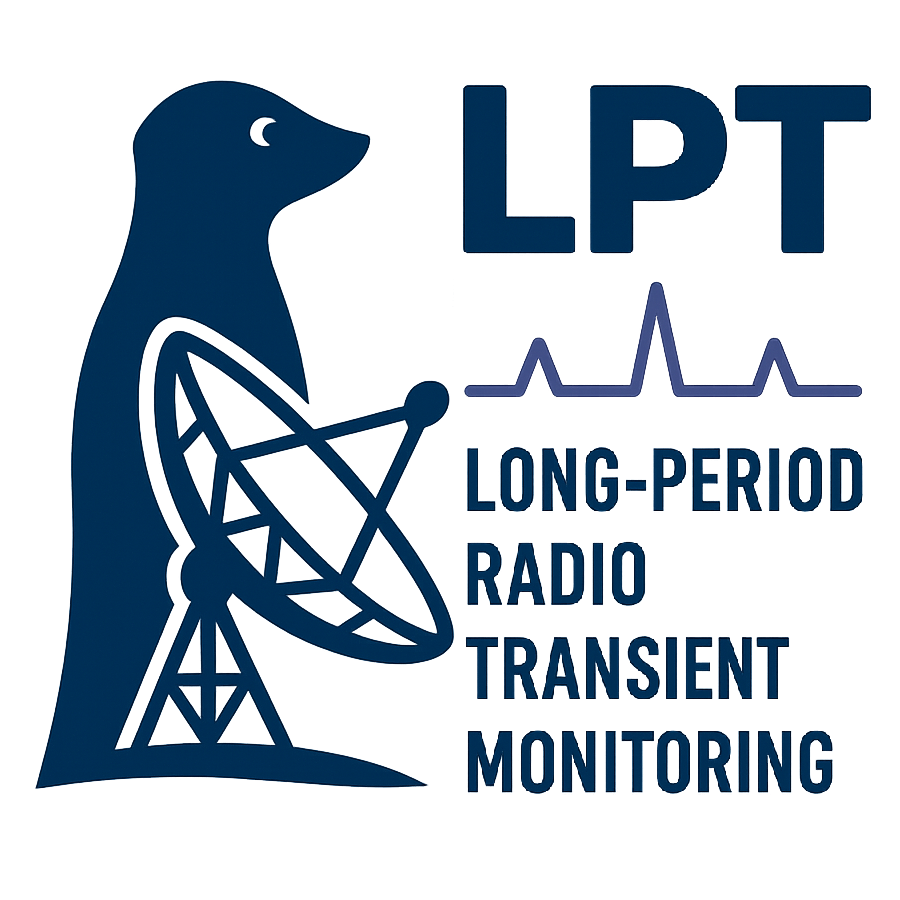

# MeerKAT Long-Period Transients



Monitoring long-period radio transients with MeerKAT (project SCI-20251201-ID-01).

**Website: <https://meerkat-lpts.github.io/public/>**: targets and papers, completed observations,
times of arrival, software and contact details.

## Editing the website

All pages are Markdown files in [`docs/`](docs/); the tables are read from the CSV files in
[`docs/data/`](docs/data/). Every push to `main` rebuilds the site automatically.

| To update | Edit |
|---|---|
| Targets and papers | `docs/data/targets.csv` |
| Completed observations | `docs/data/schedule.csv` |
| Times of arrival | `docs/data/toas/all_toas.csv` and the `.tim` files |
| Text of any page | `docs/*.md` |

Preview locally:

```bash
pip install -r requirements.txt
mkdocs serve          # then open http://127.0.0.1:8000
```
