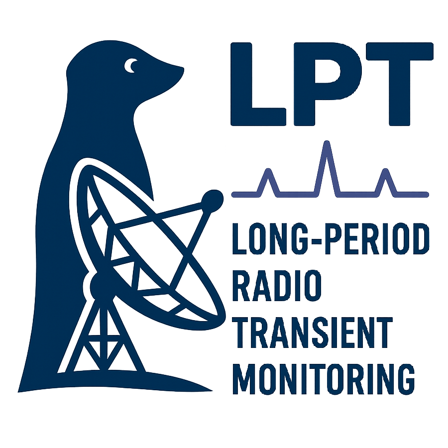

# MeerKAT Long-Period Transients

**Monitoring long-period radio transients with MeerKAT** (project SCI-20251201-ID-01).

Long-period radio transients (LPTs) are Galactic radio sources that emit bright, highly polarised
pulses with periods of minutes to hours, much longer than ordinary radio pulsars. Several have been
shown to be white dwarfs in binaries with M-dwarf companions, while the nature of others is still open.
This project uses regular MeerKAT observations to follow how their pulses, brightness and polarisation
change over time.

-   :material-star-four-points: **[Targets](targets.md)**

    The sources we monitor, their positions, periods and DMs, and the papers about them.

-   :material-calendar-month: **[Observations](schedule.md)**

    When each source was observed, for how long, and in which band.

-   :material-timer-outline: **[Times of arrival](toas.md)**

    Pulse arrival times from our observations, as a table and as `.tim` files.

-   :material-tools: **[Software](software.md)**

    The tools we use for searching, imaging and polarimetry.

-   :material-email-outline: **[Contact](contact.md)**

    Questions, data requests and collaboration.

